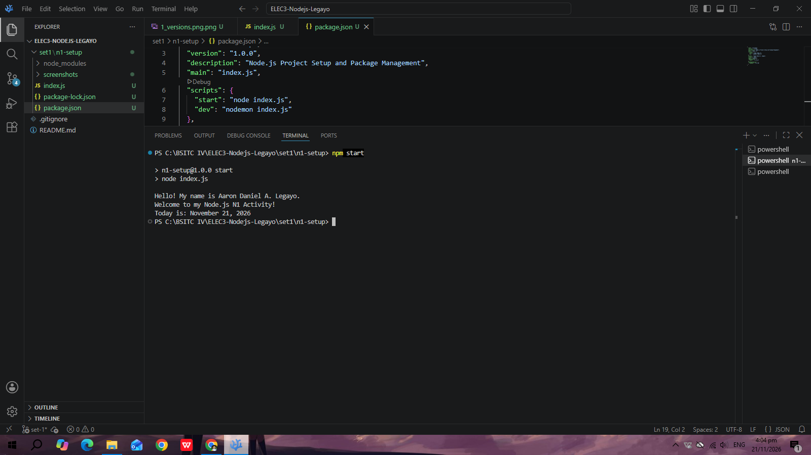
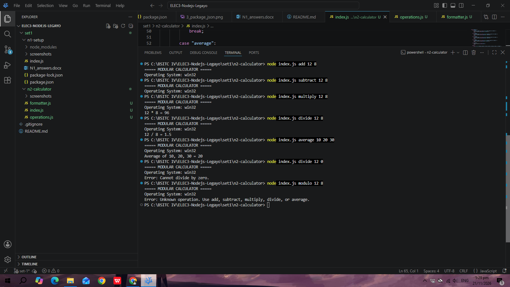

## Activities

| Activity                | Description                                                | Folder                           |
| ----------------------- | ---------------------------------------------------------- | -------------------------------- |
| N1 – Project Setup      | Node.js project initialization and npm package management. | [N1 Folder](set1/n1-setup/)      |
| N2 – Modular Calculator | A command-line calculator using custom JavaScript modules. | [N2 Folder](set1/n2-calculator/) |
| N3 – File Manager       | A command-line program for creating, reading, updating, deleting, and listing text files. | [N3 Folder](set1/n3-file-manager/) |

## Activity Details

### N1 – Project Setup and Package Management

**Description:** Initialized a Node.js project, installed npm packages, and configured package.json scripts and dependencies.

**How to run:**

Run these commands inside `set1/n1-setup`:

```bash
npm install
npm start
```

**Screenshots:**





### N2 – Modular Calculator

**Description:** Created a command-line calculator using custom modules for mathematical operations and result formatting.

**How to run:**

Run these commands inside `set1/n2-calculator`:

```bash
node index.js add 12 8
node index.js subtract 12 8
node index.js multiply 12 8
node index.js divide 12 8
node index.js average 10 20 30
node index.js divide 12 0
node index.js modulo 12 8
```

**Screenshots:**




### N3 – File Manager

**Description:** Created a command-line file manager using Node.js modules to create, read, update, delete, and list text files.

**How to run:**

Run these commands inside `set1/n3-file-manager`:

```bash
node index.js create notes.txt "This is my first note."
node index.js read notes.txt
node index.js update notes.txt " Updated content."
node index.js delete notes.txt
node index.js list
```

**Screenshots:**


