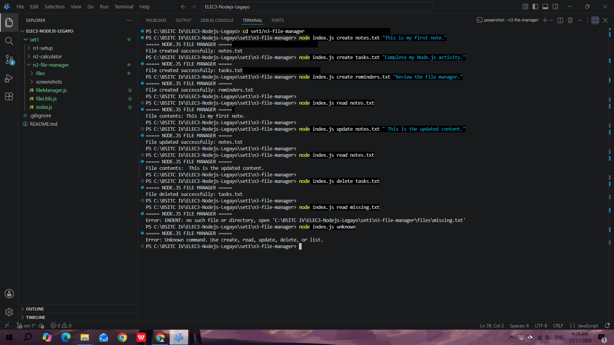
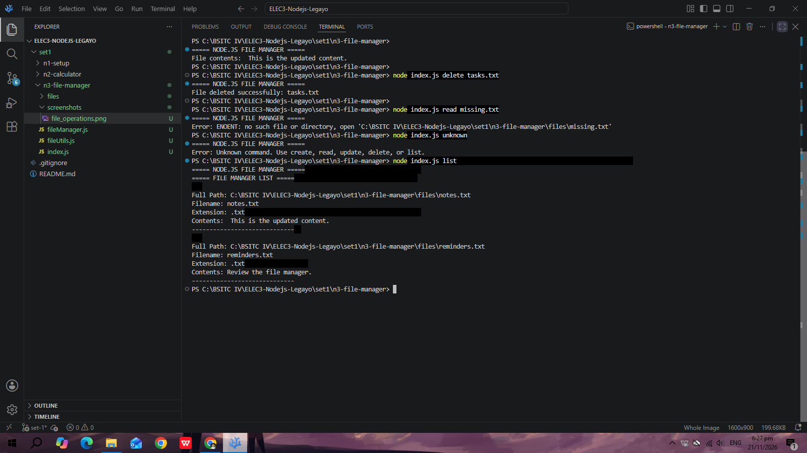
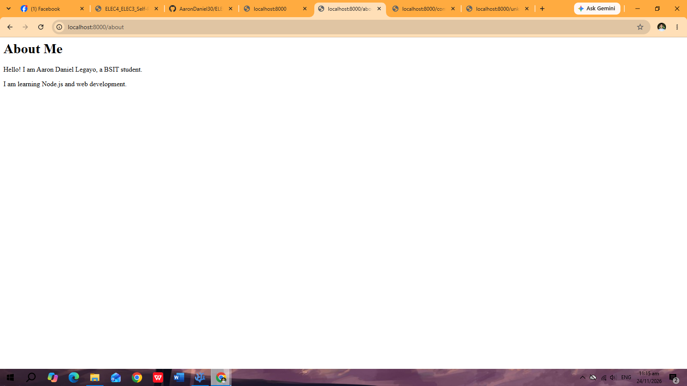
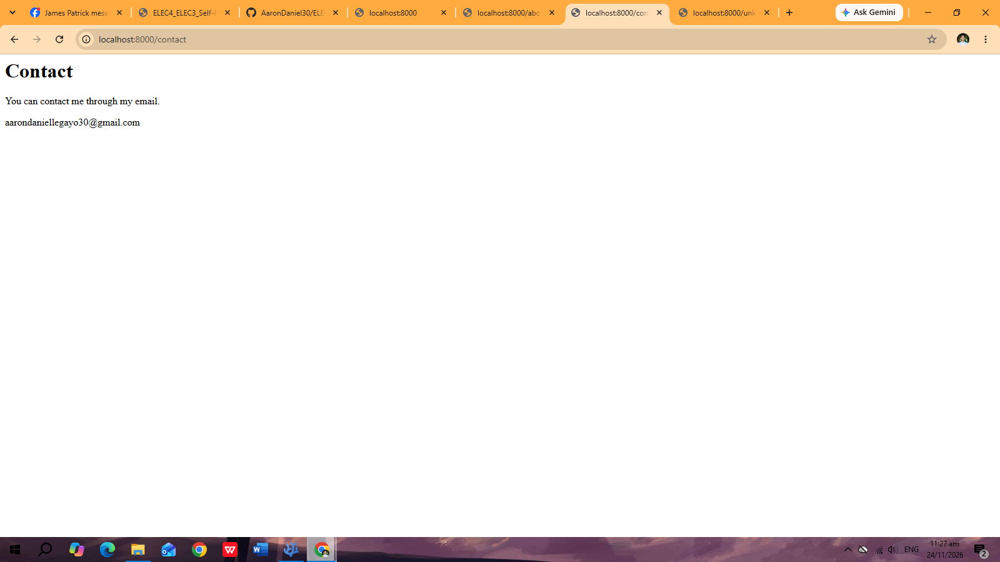
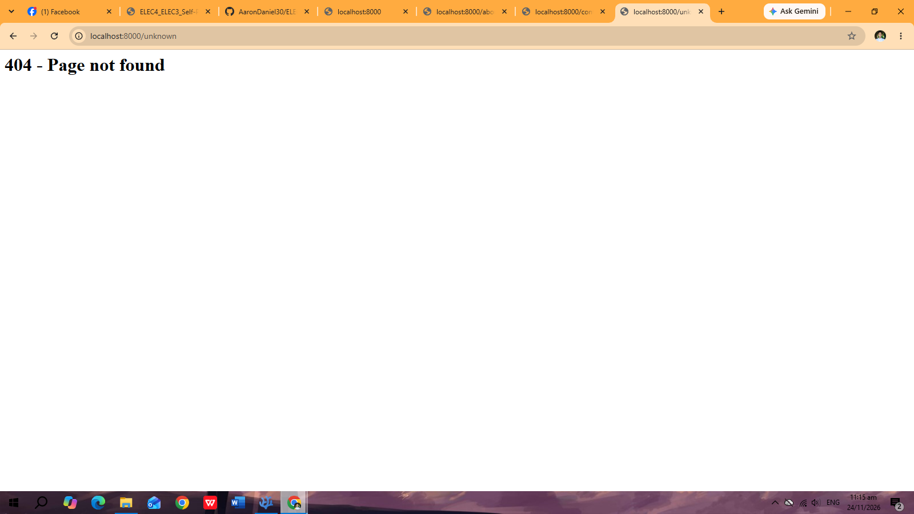
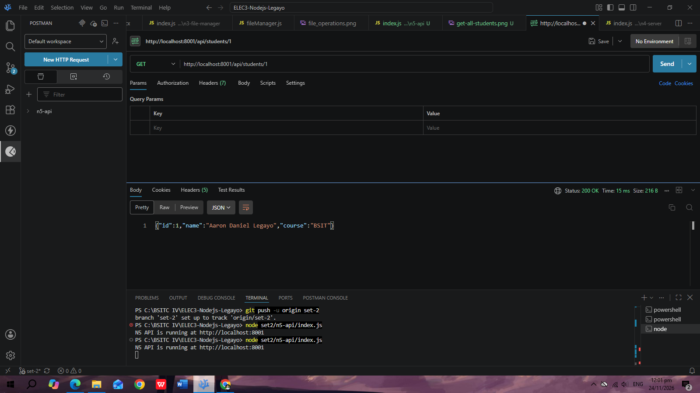
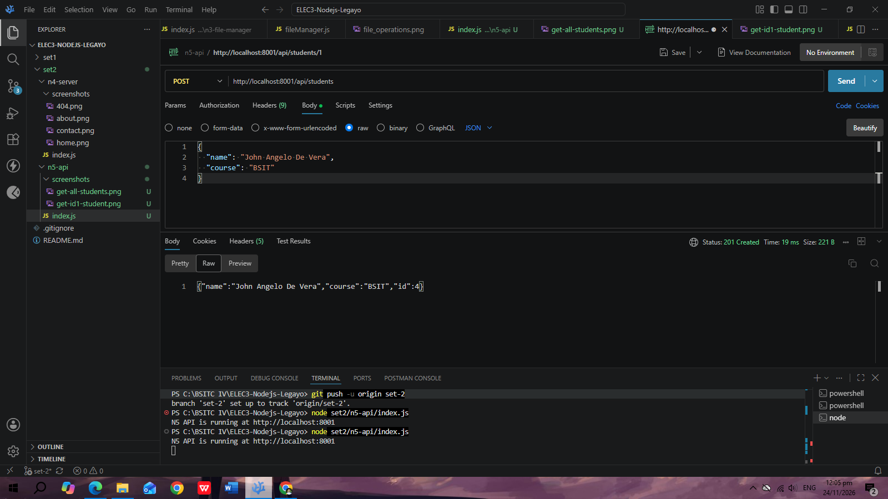
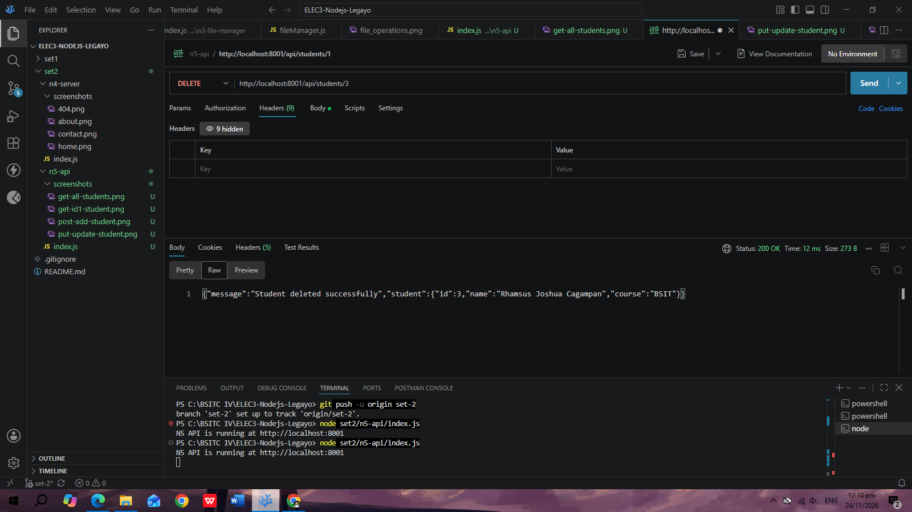
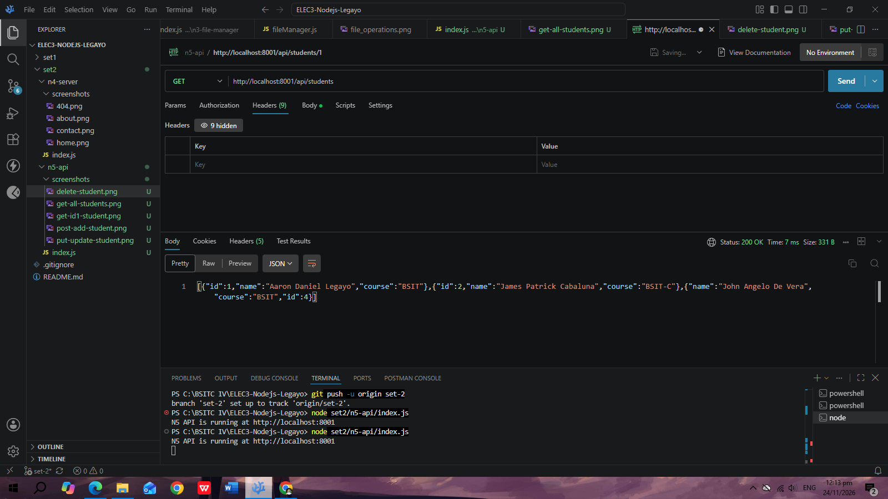

# ELEC 3 – Node.js Programming Activities

**Name:** Aaron Daniel Legayo  
**Section:** IV-BSIT  
**Course:** ELEC 3 – Node.js Programming

## Activities

| Activity | Description | Folder |
|---|---|---|
| N1 – Project Setup | Node.js project initialization and npm package management. | [N1 Folder](set1/n1-setup/) |
| N2 – Modular Calculator | A command-line calculator using custom JavaScript modules. | [N2 Folder](set1/n2-calculator/) |
| N3 – File Manager | A command-line program for creating, reading, updating, deleting, and listing text files. | [N3 Folder](set1/n3-file-manager/) |
| N4 – Basic HTTP Server | A basic HTTP server with page routing and 404 error handling. | [N4 Folder](set2/n4-server/) |
| N5 – REST-style API | A REST-style student API that supports CRUD operations using an array for storage. | [N5 Folder](set2/n5-api/) |

## Activity Details

### N1 – Project Setup and Package Management

**Description:** Initialized a Node.js project, installed npm packages, and configured package.json scripts and dependencies.

**How to run:**

Run these commands inside `set1/n1-setup`:

```bash
npm install
npm start
```

**Screenshots:**


### N2 – Modular Calculator

**Description:** Created a command-line calculator using custom modules for mathematical operations and result formatting.

**How to run:**

Run these commands inside `set1/n2-calculator`:

```bash
node index.js add 12 8
node index.js subtract 12 8
node index.js multiply 12 8
node index.js divide 12 8
node index.js average 10 20 30
node index.js divide 12 0
node index.js modulo 12 8
```

**Screenshots:**


### N3 – File Manager

**Description:** Created a command-line file manager using Node.js modules to create, read, update, delete, and list text files.

**How to run:**

Run these commands inside `set1/n3-file-manager`:

```bash
node index.js create notes.txt "This is my first note."
node index.js read notes.txt
node index.js update notes.txt " Updated content."
node index.js delete notes.txt
node index.js list
```

**Screenshots:**





### N4 – Basic HTTP Server

**Description:** Created a basic HTTP server using Node.js's built-in HTTP module. The server handles the home, about, and contact pages and displays a 404 error for unknown routes.

**How to run:**

Run this command from the project root:

```bash
node set2/n4-server/index.js
```

Open the server in your browser:

```text
http://localhost:8000
```

**Available routes:**

- `/` – Home page
- `/about` – About page
- `/contact` – Contact page
- Other URLs – 404 Page not found

**Screenshots:**








### N5 – REST-style API

**Description:** Created a REST-style API using Node.js's built-in HTTP module. It manages student records using an array without a database and supports Create, Read, Update, and Delete (CRUD) operations.

**How to run:**

Run this command from the project root:

```bash
node set2/n5-api/index.js
```

The API runs at:

```text
http://localhost:8001
```

**Available endpoints:**

| Method | Endpoint | Description |
|---|---|---|
| GET | `/api/students` | Retrieve all students. |
| GET | `/api/students/:id` | Retrieve a student by ID. |
| POST | `/api/students` | Add a new student. |
| PUT | `/api/students/:id` | Update an existing student. |
| DELETE | `/api/students/:id` | Delete a student by ID. |

**Example POST request body:**

```json
{
  "name": "Ana Reyes",
  "course": "BSIT"
}
```

**Screenshots:**









