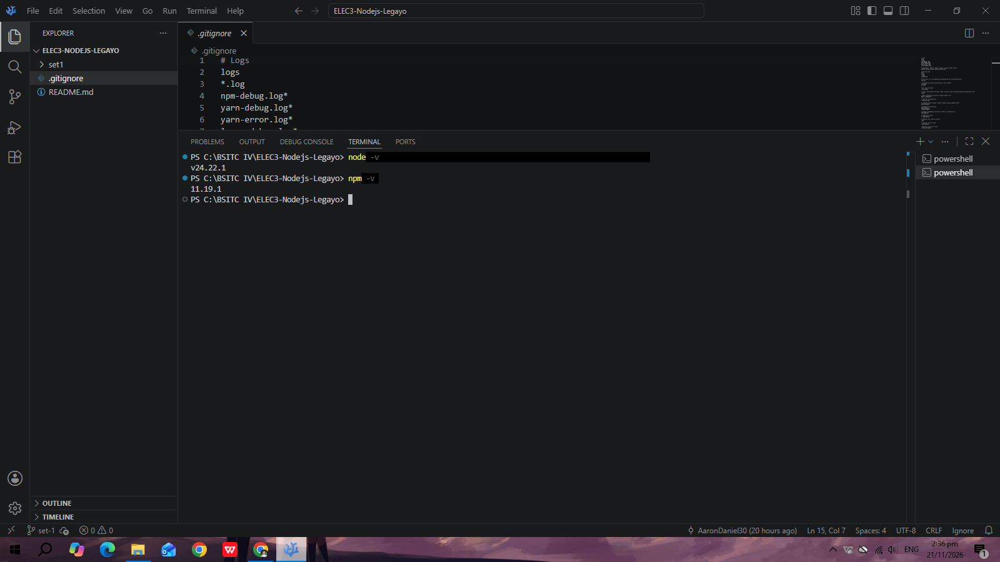
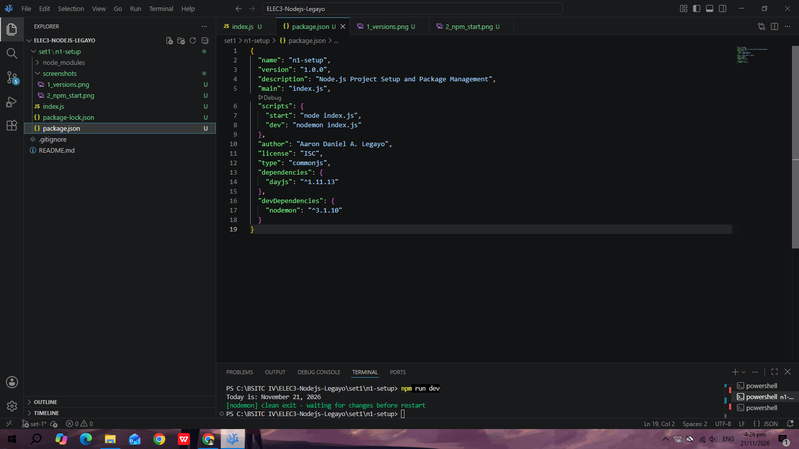

## Activities

| Activity | Description | Folder |
|---|---|---|
| N1 – Project Setup | Node.js project initialization and npm package management. | [N1 Folder](set1/n1-setup/) |

## Activity Details

### N1 – Project Setup and Package Management

**Description:** Initialized a Node.js project, installed npm packages, and configured package.json scripts and dependencies.

**How to run:**

Run these commands inside `set1/n1-setup`:

    npm install
    npm start

**Screenshots:**

