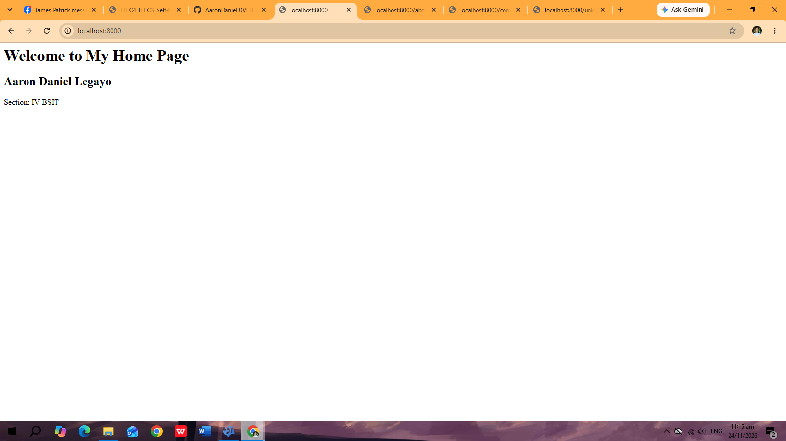
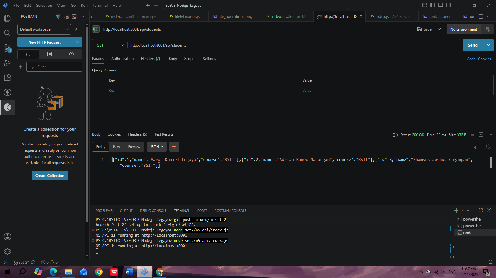
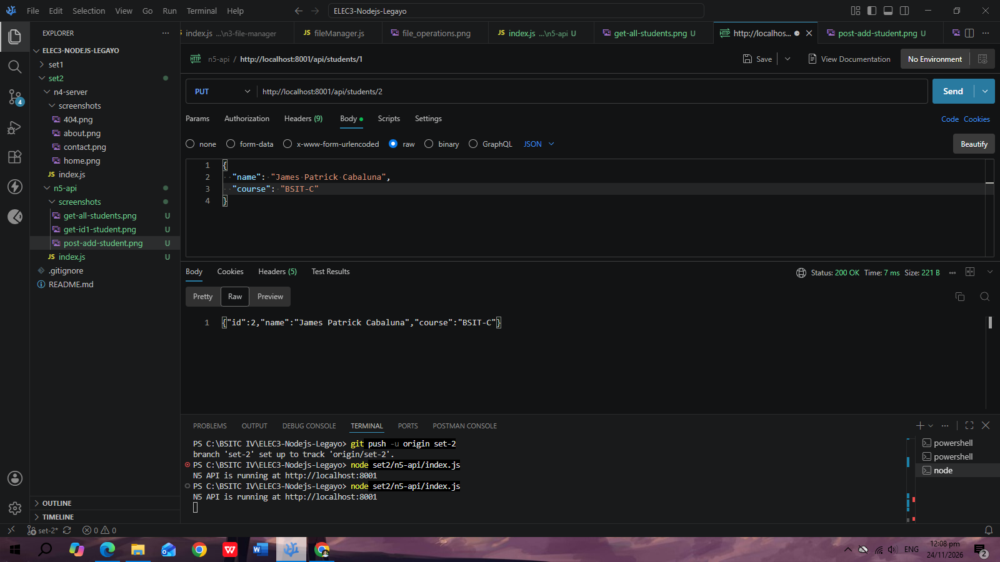
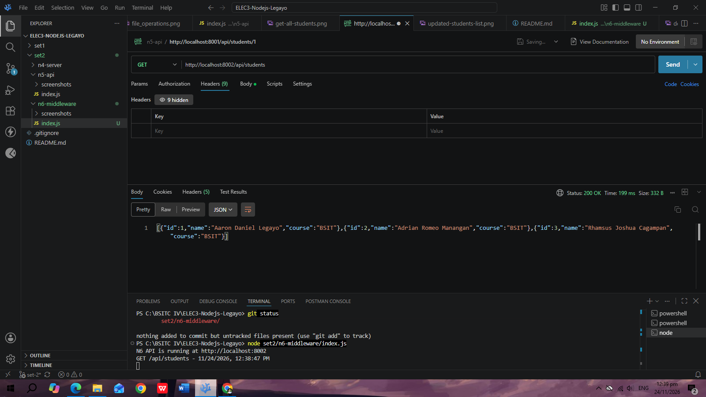
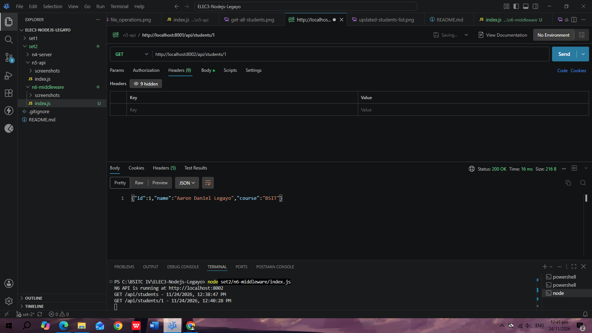
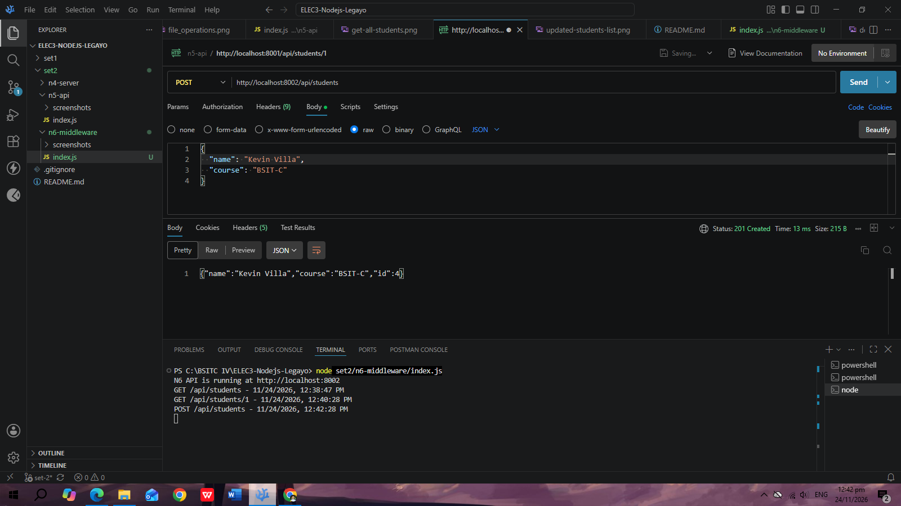
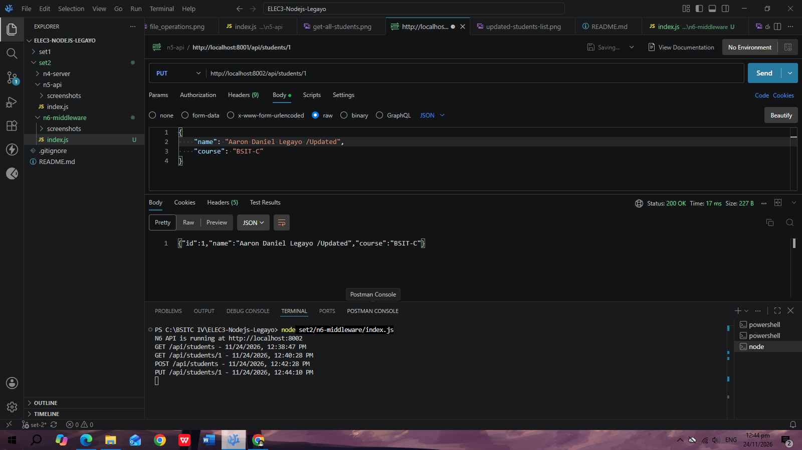
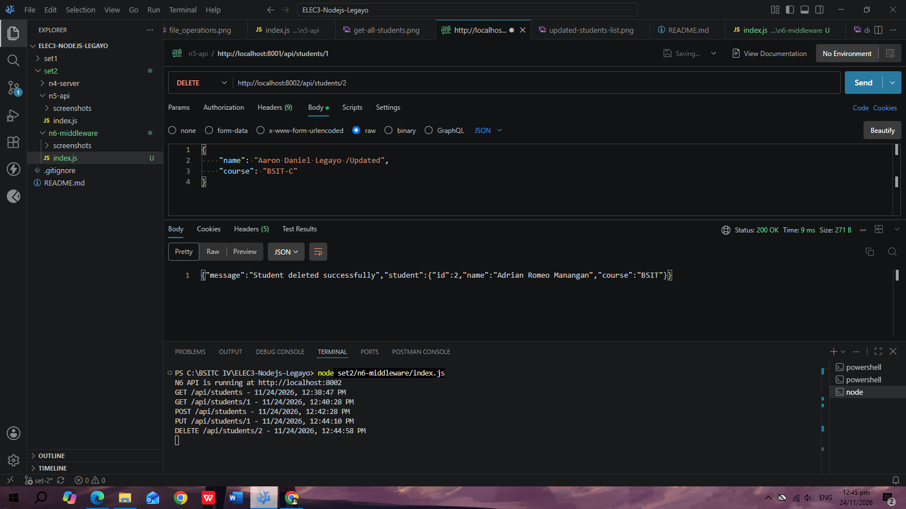
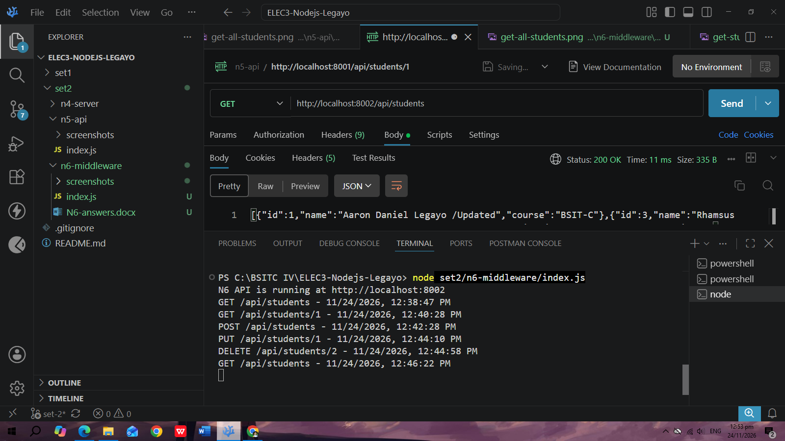

# ELEC 3 – Node.js Programming Activities

**Name:** Aaron Daniel Legayo  
**Section:** IV-BSIT  
**Course:** ELEC 3 – Node.js Programming

## Set 2 Activities

| Activity | Description | Folder |
|---|---|---|
| N4 – Basic HTTP Server | A basic HTTP server with page routing and 404 error handling. | [N4 Folder](set2/n4-server/) |
| N5 – REST-style API | A REST-style student API that supports CRUD operations using an array for storage. | [N5 Folder](set2/n5-api/) |
| N6 – Middleware and API Testing | Custom logger and JSON middleware with REST API testing using Postman. | [N6 Folder](set2/n6-middleware/) |

---

## N4 – Basic HTTP Server

**Description:** Created a basic HTTP server using Node.js's built-in HTTP module. The server handles the home, about, and contact pages and displays a 404 error for unknown routes.

**How to run:**

Run this command from the project root:

```bash
node set2/n4-server/index.js
```

**Server URL:**

```text
http://localhost:8000
```

**Available routes:**

- `/` – Home page
- `/about` – About page
- `/contact` – Contact page
- Other URLs – 404 Page not found

**Screenshots:**




---

## N5 – REST-style API

**Description:** Created a REST-style API using Node.js's built-in HTTP module. It manages student records using an array without a database and supports Create, Read, Update, and Delete (CRUD) operations.

**How to run:**

```bash
node set2/n5-api/index.js
```

**Server URL:**

```text
http://localhost:8001
```

**Available endpoints:**

| Method | Endpoint | Description |
|---|---|---|
| GET | `/api/students` | Retrieve all students. |
| GET | `/api/students/:id` | Retrieve a student by ID. |
| POST | `/api/students` | Add a new student. |
| PUT | `/api/students/:id` | Update an existing student. |
| DELETE | `/api/students/:id` | Delete a student by ID. |

**Example POST request body:**

```json
{
  "name": "Ana Reyes",
  "course": "BSIT"
}
```

**Screenshots:**







---

## N6 – Middleware and API Testing

**Description:** Implemented custom logger and JSON middleware using Node.js. Tested all five REST API operations (GET, GET by ID, POST, PUT, and DELETE) using Postman.

**How to run:**

```bash
node set2/n6-middleware/index.js
```

**Server URL:**

```text
http://localhost:8002
```

**API Endpoints:**

| Method | Endpoint | Description |
|---|---|---|
| GET | `/api/students` | Get all students |
| GET | `/api/students/:id` | Get a student by ID |
| POST | `/api/students` | Add a new student |
| PUT | `/api/students/:id` | Update a student |
| DELETE | `/api/students/:id` | Delete a student |

**Screenshots:**

**1. GET – All Students**



**2. GET – Student by ID**



**3. POST – Add Student**



**4. PUT – Update Student**



**5. DELETE – Remove Student**



**6. Middleware Logger Output**



**N6 Answers:**

[View N6 Answers](set2/n6-middleware/N6-answers.docx)
